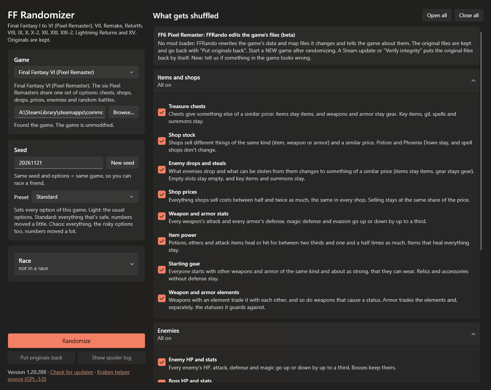
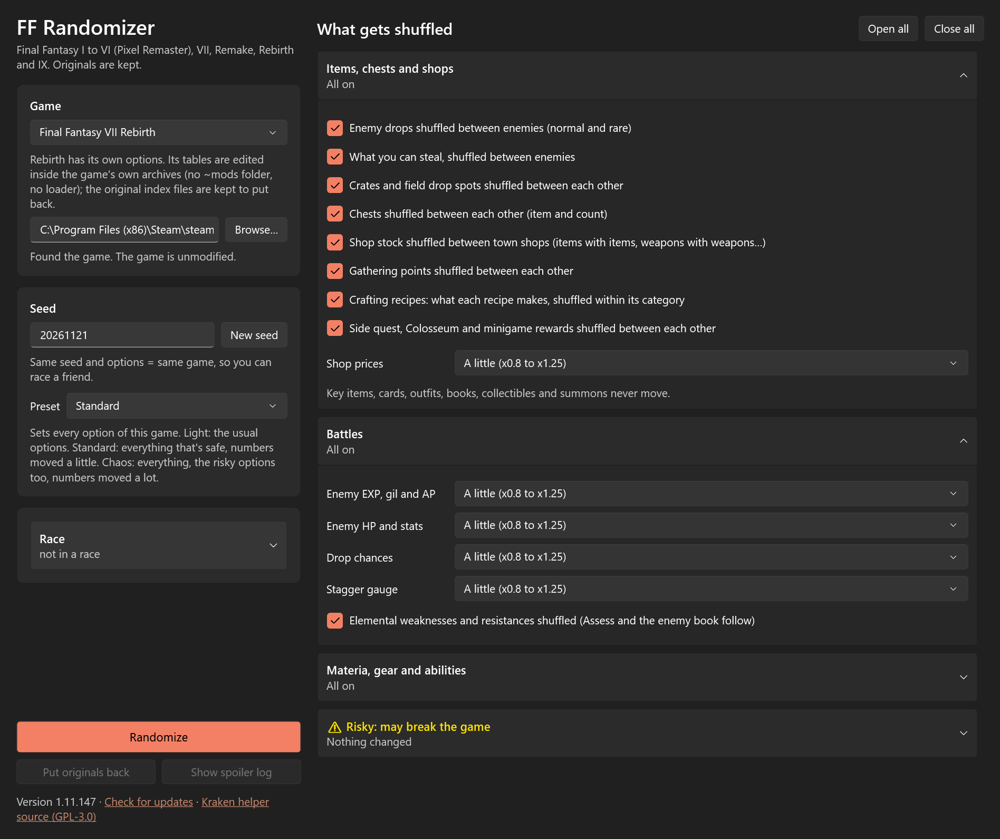
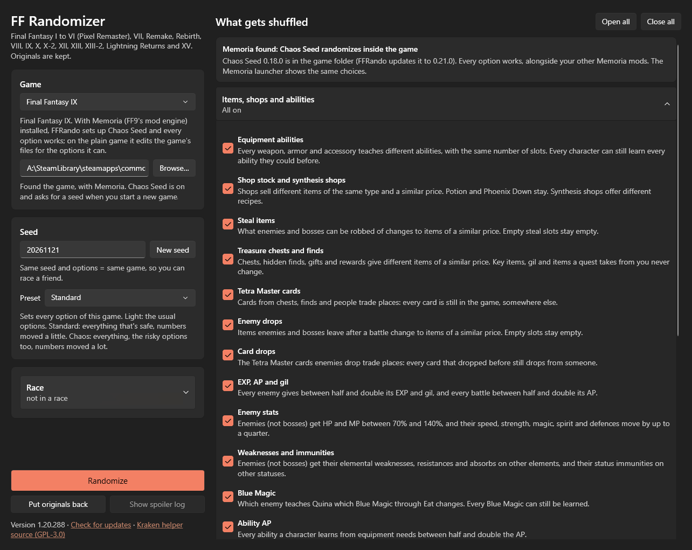
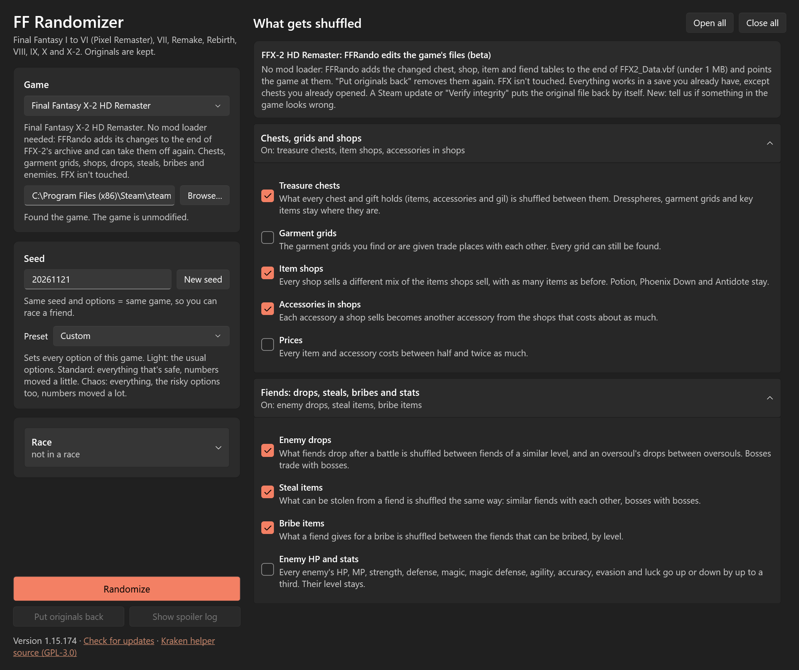
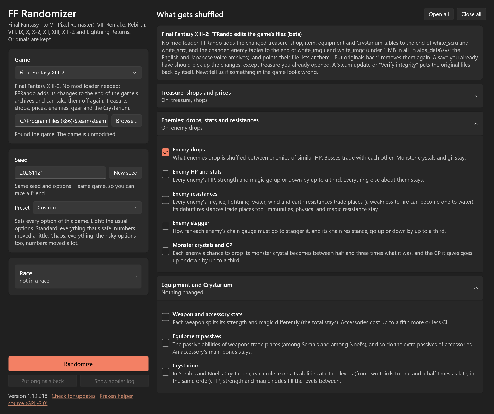
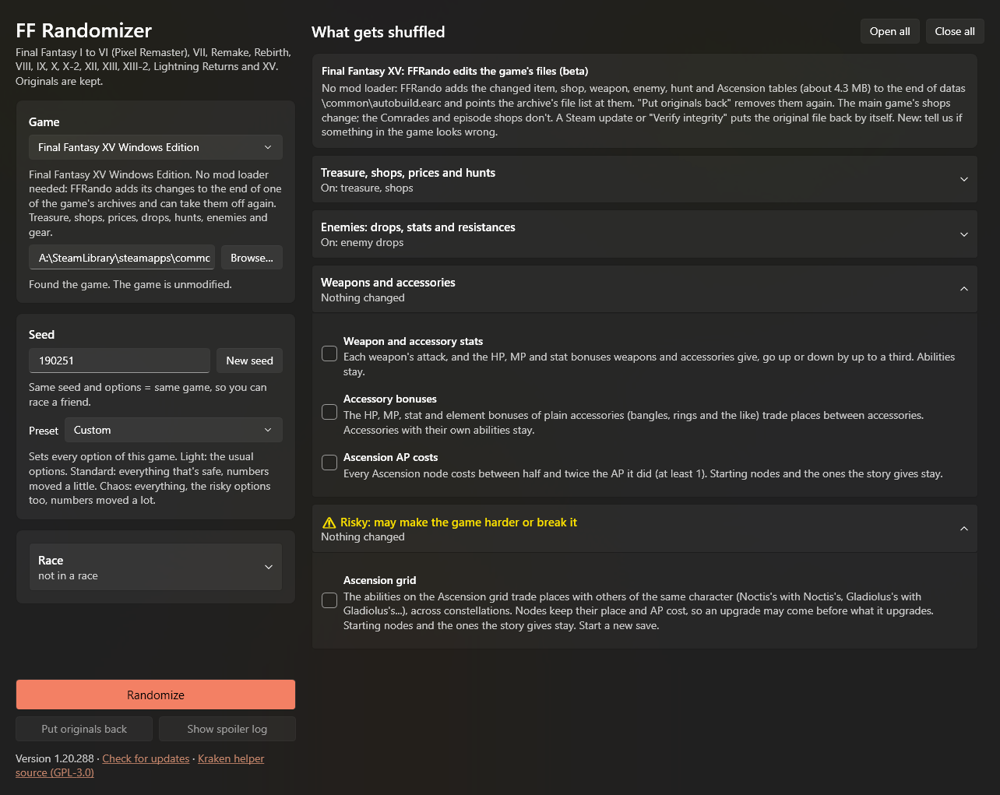

# FF Randomizer

A randomizer for **Final Fantasy** on PC (Steam):

- **Final Fantasy I, II, III, IV, V and VI**: the Pixel Remasters.
- **Final Fantasy VII**: the original game (both the current Steam release and the 2013 one), **Remake Intergrade** and **Rebirth**.
- **Final Fantasy VIII**: the 2013 Steam release and the Remaster.
- **Final Fantasy IX**, with or without the Memoria mod engine.
- **Final Fantasy X** and **Final Fantasy X-2**: the HD Remaster. Each is randomized on its own.
- **Final Fantasy XII The Zodiac Age**.
- **Final Fantasy XIII**, **Final Fantasy XIII-2** and **Lightning Returns: Final Fantasy XIII**.
- **Final Fantasy XV Windows Edition**.

Pick a seed, tick what to shuffle, press **Randomize**, and play. It was called FF7Rando until version 1.5.72.

- **No mod loader needed.** No 7th Heaven, FFNx, Reloaded-II or anything else to install for FF7, FF8, FFX, FFX-2, FFXII, FFXIII, FFXIII-2, Lightning Returns, FFXV or the Pixel Remasters. It changes the game itself. For FF9 it works on the plain game, and does even more if you have Memoria.
- **Your originals are kept.** **Put originals back** undoes everything, whenever you like.
- **Seeds.** The same seed and options always give the same game, so you can race a friend on the same shuffle.
- **Races.** For every game: join a race with an invite link or host one yourself, with a live leaderboard.
- **Spoiler log.** Every randomize writes one, and the app shows it in its own window, so you can look up where something went.

## Download

**[⬇ Latest release](https://github.com/Ozmao/ffrando-releases/releases/latest)**: download `FFRando.exe`.

- It's a single file with nothing to install, for 64-bit Windows 10 or 11. Keep it somewhere you can write to, such as your Desktop or Documents. Updates can't be installed inside Program Files.
- **It updates itself.** When a new version is out, a banner at the top of the window offers it. One click downloads it, checks it against the checksum GitHub has for it, and restarts. FF7Rando 1.4.60 updates to FFRando by itself.
- **Version numbers** read 1.*games supported*.*features released*: 1.14.165 supports 14 games and has 165 features.
- The exe isn't code-signed, so Windows SmartScreen may warn you the first time. Click **More info → Run anyway**.

## How to use it

1. **Close the game.**
2. Pick the game in the **Game** list. Steam installs are found automatically. If yours isn't, use **Browse…** to point at the game folder.
3. Type a seed or press **New seed**, then pick your options. Each game has its own set. A **Preset** sets them all at once: **Light** (the usual options), **Standard** (everything that's safe, numbers moved a little) or **Chaos** (everything, the risky options too, numbers moved a lot).
4. Press **Randomize**.
5. Start the game. In the original FF7, FF9 and the Pixel Remasters, start a **new game**: starting materia, items and gear only apply to a new game, FF9's Chaos Seed randomizes when a new game starts, and chests already opened in a save stay opened. Drops, chests, shops and the rest of FF7's options apply everywhere, and so do all of FF8's. FFX's, FFX-2's, FFXII's, FFXIII's, FFXIII-2's, Lightning Returns' and FFXV's options work in a save you already have too, except for chests you already opened and the few options whose description says to start a new game (such as FFX's sphere grid and FFXV's Ascension grid).
6. To go back to the normal game, press **Put originals back**. Do this before using Steam's *Verify integrity of game files*.

Every randomize starts from the original files, so seeds never stack. Backups and spoiler logs are saved in an `FFRando` folder inside the game's folder.

## What it can shuffle

### Final Fantasy I to VI (Pixel Remaster, beta)

All six share most options:

- **On by default:** treasure chests, shop stock, and enemy drops and steals. Each becomes something of a similar price: items stay items, and weapons and armor stay gear.
- **Off by default:**
  - shop prices (half to twice as much), and weapon and armor stats;
  - enemy HP and stats, boss HP and stats, enemy weaknesses and immunities, enemy EXP and gil, and enemy levels (FF3 to FF6);
  - item power, starting gear, battle backgrounds, and weapon and armor elements;
  - character stats and growth, faster leveling (not FF2), spell power and MP cost, and music;
  - enemy accuracy and evasion, enemy types (undead, dragon...), enemy MP (FF2, FF4 to FF6), enemy speed (FF1, FF3 to FF6), enemy hits per attack (FF1, FF2) and stat bonuses on gear (FF2 to FF6). Bosses keep theirs.
- **For some games only:** spells learned by level (FF4, FF6), job stats (FF3, FF5), job abilities and job ABP costs (FF5), esper spells, esper learning rates, Mog's dances and Gau's Rages (FF6).
- **⚠ Risky:** random encounters (each swapped for a battle of a similar level), who can equip what, job commands (FF3, FF5), double bosses, boss shuffle and enemy starting statuses (Float, Haste, Reflect... trade between enemies).

Key items, gil, spells, summons (FF4's and FF5's summon items, FF3's spell items, FF2's tomes) and boss fights never move. FFRando rewrites the game's own data files and keeps the originals in the `FFRando` folder. Steam's *Verify integrity* or an update also puts the originals back.

### Final Fantasy VII (Steam release and 2013)

Enemy drops, steals and morphs · items in chests and materia lying around · shops and shop prices · random battles (at a similar level, or anywhere) · enemy HP and stats · spells between magic materia · summons between summon materia · materia slots on gear · starting materia, items and gear · stat growth · the order limit breaks are learned in (or, experimentally, limits between characters).

Off by default: boss HP and stats · EXP, AP and gil · elemental weaknesses and status immunities · weapon and armor stats · materia growth on gear · accessory effects · spell power and MP · materia AP · item power (Potions, Ethers, Grenades...) · new elements for elemental armor · battle backgrounds · world map battles (moved between areas, chocobo battles stay) · drop and steal chances · enemy levels · enemy attack power · elements on weapons · limit break needs · materia stat changes (Mag +1, HP -2%...) · starting stats · starting HP and MP · stat bonuses on gear · enemy MP · escape difficulty.

**⚠ Risky:** field music, double bosses, boss shuffle and surprise attacks (about one battle in four you can run from starts as a back attack or a preemptive strike).

On the new Steam release, chests and random battles are only shuffled when playing in English.

### Remake Intergrade

On by default: enemy drops and steals · Shinra boxes · chests · shop prices.

Off by default:

- Shop stock, enemy EXP, gil and AP, and enemy HP and stats.
- Elemental weaknesses. The enemy book and Assess show the new ones.
- Chadley's materia.
- Armor and accessory effects.
- Side quest, Colosseum and other rewards.
- Starting armor and materia.
- Spells between magic materia, and the effects of command, support and independent materia.
- Weapon abilities and weapon upgrade skills.
- Weapon attack and magic attack.
- Drop chances, stagger gauges, stagger time and materia AP.
- Stat growth between Cloud, Barret, Tifa and Aerith.
- Armor defense, party HP and MP, materia stat bonuses (max MP +2%, Magic +1...) and enemy levels.
- **⚠ Risky:** enemy groups between fights, Fort Condor opponents, music and weapon materia slots (starting weapons keep theirs).

Remake isn't changed at all: everything goes into one mod file (`End\Content\Paks\~mods\FFRando_P.pak`), and **Put originals back** deletes it.

### Rebirth

On by default: enemy drops and steals · crates and field drop spots · chests · shop prices.

Off by default:

- Shop stock, enemy EXP, gil and AP, and enemy HP and stats.
- Gathering points and crafting recipes.
- Elemental weaknesses.
- Chadley's materia.
- Armor and accessory effects.
- Side quest, Colosseum and minigame rewards.
- Starting gear.
- Spells between magic materia, and the other materia kinds.
- Weapon abilities.
- Weapon attack and magic attack.
- Drop chances, stagger gauges, stagger time and materia AP.
- Armor defense, party HP and MP, materia stat bonuses and enemy levels.
- **⚠ Risky:** roaming enemies, Queen's Blood decks, field music, Folio skill trees, Queen's Blood card power and weapon materia slots.

Key items, summons and other things the story needs never move.

### Final Fantasy VIII (beta)

Both Steam releases: **FINAL FANTASY VIII** (2013) and **FINAL FANTASY VIII Remastered**. There's no mod loader to install. FFRando adds the changed files to the end of the game's own archives (`battle.fs` and `menu.fs` in the 2013 release, `main.zzz` in the Remaster, for every language) and points the game at them. **Put originals back** removes them again. The Remaster's `main.zzz` grows by about 470 MB while the game is randomized.

- **Enemy drops** and **Mug items**: monsters trade with monsters and bosses with bosses, and each slot keeps its level range.
- **Shop stock**: every shop sells a different mix. Potion, Phoenix Down and Normal Ammo stay, and items that need Familiar still do. **Shop prices** can go from half to double.
- **Draw lists**: shuffled within each level range. Guardian Forces stay where they are.
- **Enemy cards**: the cards monsters turn into with the Card command.
- **Enemy HP and stats** and **enemy elements** (off unless you tick them).
- **Enemy status resistances** (off unless you tick it): each enemy's partial resistances to ailments trade places. What it's immune to, or not resistant to at all, stays.
- **Enemy EXP and AP** (off unless you tick it): up or down by up to a third.
- Off unless you tick them:
  - **Mug and drop rates**: each enemy's chance to be mugged and to drop an item goes from half to twice what it was. Sure ones stay sure.
  - **Level thresholds**: the levels at which enemies move on to their mid- and high-level draws, mugs, drops and attacks.
  - **GF abilities**: the abilities the 16 GFs can learn are shuffled between them (21 each, no repeats). Magic, GF, Draw and Item stay, and what a GF already learned in your save stays learned.
  - **Ability AP costs**, **GF power and HP**, **spell power**, **junction values**, **weapon stats**, **limit break power** and **battle item power**: each goes up or down, on its own.
  - **Weapon upgrade costs**: the gil and item counts the Junk Shop wants.
  - **Draw difficulty**, **stat-up ability values**, **GF EXP per level**, **Selphie's Slot spells** and **Devour results**.
  - **⚠ Risky:** character stat growth, enemy attack power, weapon upgrade items (shuffled between all upgrades, so an early weapon may need a rare item), status durations and character EXP per level (a save made before shows other levels).

Everything works in a save you already have. It hasn't been tried in the game yet, so please report anything that looks wrong.

### Final Fantasy IX

How FF9 gets randomized depends on whether **[Memoria](https://github.com/Albeoris/Memoria)** (FF9's mod engine) is installed. The card at the top of the FF9 panel says which way your install goes.

- **With Memoria:** FFRando installs the **Chaos Seed** mod and switches it on in Memoria's mod list, alongside your other Memoria mods. Every option works, and Chaos Seed randomizes inside the game when you start a new game. The Memoria launcher shows the same choices.
- **Plain game (beta):** without Memoria, FFRando writes the same shuffles straight into the game's files. Options it can't do this way are marked **needs Memoria** in the window and greyed out.

| Option | Plain game | With Memoria |
| --- | --- | --- |
| Equipment abilities | yes | yes |
| Shop stock and synthesis shops | yes | yes |
| Steal items | yes | yes |
| Treasure chests and finds | yes | yes |
| Tetra Master cards | yes | yes |
| Enemy drops | yes | yes |
| Card drops | yes | yes |
| EXP, AP and gil | yes | yes |
| Enemy stats | yes | yes |
| Weaknesses and immunities | yes | yes |
| Blue Magic (who teaches what) | yes | yes |
| Ability AP | yes | yes |
| Weapon and armor stats | yes | yes |
| Spell power and MP | yes | yes |
| Starting equipment (needs a new game) | yes | yes |
| Character stats (the party trades base stats) | yes | yes |
| Magic stone costs | yes | yes |
| Item prices | yes | yes |
| Who can wear armor | yes | yes |
| Enemy attack power | yes | no (plain game only) |
| Enemy attack elements | yes | no (plain game only) |
| Enemy levels | yes | no (plain game only) |
| Stat bonuses on gear | yes | no (plain game only) |
| Weapon elements and statuses | yes | no (plain game only) |
| ⚠ Synthesis recipes | yes | yes |
| ⚠ Boss stats | yes | yes |
| ⚠ Double bosses | yes | yes |
| ⚠ Random encounters | needs Memoria | yes |
| ⚠ Key items | needs Memoria | yes |
| Cutscene skipper (doesn't change the seed) | needs Memoria | yes |

### Final Fantasy X (beta)

**FINAL FANTASY X/X-2 HD Remaster** on Steam. Only FFX is changed here; FFX-2 has its own entry in the list (below). There's no mod loader to install. FFRando adds the changed files to the end of the game's archive (`data\FFX_Data.vbf`, about 16 MB) and points the game at them. **Put originals back** removes them again.

- **Treasure chests**: what every chest and gift holds (items, gil and equipment) is shuffled between them. Key items stay where they are.
- **Item shops**: every shop sells a different mix with as many items as before. Potion, Phoenix Down and Antidote stay.
- **Weapon shops**: each weapon and armor becomes another one for the same character, from what the shops around that point of the story sell.
- **Enemy drops**, **steal items** and **bribe items**: monsters trade with monsters of a similar strength, and bosses with bosses.
- **Item prices**, **equipment drops** (the abilities and slots of the gear monsters drop) and **enemy HP and stats** (off unless you tick them).
- **Enemy resistances** (off unless you tick it): every monster's fire, ice, lightning, water and holy weaknesses and resistances trade places, and so do its status resistances. Immunities stay. Scan's written tips may still describe the old ones.
- **Enemy AP and gil** (off unless you tick it): up or down by up to a third, overkill AP too.
- Off unless you tick them:
  - **Equipment drop chances** and **overkill thresholds**.
  - **Boss HP and stats**: on top of Enemy HP and stats if that's on too.
  - **Sphere grid**: on every grid, abilities trade places with abilities and stat nodes with stat nodes, so a character's path leads to new abilities. Locks and empty nodes stay. Needs a new game.
  - **Customize items** and **Customize amounts**: the items Rikku needs for each auto-ability trade places (Break HP Limit may take something easy to find), and how many goes from half to twice as many.
  - **Ability MP costs**, **spell and skill power**, **enemy attack power**, **spoils amounts** and **chest amounts**.
  - **⚠ Risky:** **Lock levels** (a Lv. 1 lock can need a Lv. 4 Key Sphere) and **Whole sphere grid** (everything trades places, locks too), both needing a new game, and **enemy attack elements**.

Everything works in a save you already have (except the sphere grid options), but chests you already opened stay opened. It hasn't been tried in the game yet, so please report anything that looks wrong.

### Final Fantasy X-2 (beta)

The same **FINAL FANTASY X/X-2 HD Remaster** install, picked as **Final Fantasy X-2 HD Remaster** in the list. Only FFX-2 is changed; FFX isn't touched. There's no mod loader to install. FFRando adds the changed tables to the end of `data\FFX2_Data.vbf` (under 1 MB) and points the game at them. **Put originals back** removes them again.

- **Treasure chests**: what every chest and gift holds (items, accessories and gil) is shuffled between them. Dresspheres, garment grids and key items stay where they are.
- **Garment grids** (off unless you tick it): the grids you find or are given trade places with each other.
- **Item shops**: every shop sells a different mix with as many items as before. Potion, Phoenix Down and Antidote stay.
- **Accessories in shops**: each accessory a shop sells becomes another one from the shops that costs about as much.
- **Enemy drops**, **steal items** and **bribe items**: fiends trade with fiends of a similar level, oversouls with oversouls, and bosses with bosses.
- **Prices** and **enemy HP and stats** (off unless you tick them).
- **Enemy resistances** (off unless you tick it): every fiend's fire, ice, lightning, water and holy weaknesses and resistances trade places, and so do its status resistances. Immunities stay, and oversouls change the same way as their fiend.
- **Enemy EXP and gil** (off unless you tick it): up or down by up to a third.
- Off unless you tick them:
  - **Drop and steal chances** and **Dressphere AP** (what each fiend gives): from half to twice what they were.
  - **Boss HP and stats**: on top of Enemy HP and stats if that's on too.
  - **Dressphere stats**: each dressphere grows its HP, MP and stats like another dressphere.
  - **Ability AP**: what each dressphere ability takes to learn, from half to twice as much.
  - **Ability MP costs**, **spell and skill power**, **enemy attack power**, **spoils amounts** and **chest amounts**.
  - **⚠ Risky:** **passive abilities between dresspheres** (a Gunner can learn Initiative; command abilities stay with their own dressphere) and **enemy attack elements**.

Everything works in a save you already have, but chests you already opened stay opened. It hasn't been tried in the game yet, so please report anything that looks wrong.

### Final Fantasy XII The Zodiac Age (beta)

**FINAL FANTASY XII THE ZODIAC AGE** on Steam. There's no mod loader to install. FFRando adds the changed tables to the end of the game's archive (`FFXII_TZA.vbf`, about 45 MB, because every language has its own copy of each map) and points the game at them. **Put originals back** removes them again.

- **Treasure chests**: what every chest holds (items, equipment and gil, with its chance to appear) trades places with chests in areas of a similar rank. Chests that come back keep coming back.
- **Shops**: the weapons, armor, accessories, items, magicks and technicks shops sell trade places with others of the same kind and rank. Potion, Phoenix Down, Antidote and gambits stay.
- **Enemy drops**, **steal items** and **poach items**: shuffled between enemies with similar HP. Bosses and marks trade with each other, and key items stay where they are.
- **Prices** and **enemy HP and stats** (off unless you tick them).
- **Weapon and armor stats** (off unless you tick it): every weapon's attack, every armor and helm's defense and magick resist, and every shield's evasion go up or down by up to a third. Accessories stay.
- **Enemy EXP, LP and clan points** (off unless you tick it): up or down by up to a third, and so does the rare gil.
- Off unless you tick them:
  - **License costs** and **chest gil**.
  - **Boss and mark HP and stats**: on top of Enemy HP and stats if that's on too.
  - **License boards**: the licenses on each of the 12 job boards trade places, so each job opens up in a new order. Essentials stay.
  - **Story and hunt rewards**: the items story events, hunts and sidequests give trade places within the same rank. Gil and key items stay.
  - **Magick MP costs**, **magick power**, **enemy ability power**, **status chances** and **chest chances**.
  - **⚠ Risky:** **licenses across all boards** (any job can get any license), **what licenses give** (a license keeps its name and cost but gives something else of the same kind), **starting gear** (needs a new game) and **enemy ability elements**.

Everything works in a save you already have, but chests you already opened stay opened. It hasn't been tried in the game yet, so please report anything that looks wrong.

### Final Fantasy XIII (beta)

**FINAL FANTASY XIII** on Steam. There's no mod loader to install. FFRando adds the changed tables to the end of the game's archives (`white_data\sys\white_imgu.win32.bin` and `white_imgc.win32.bin`, the English and Japanese voice versions, at most about 230 KB each) and points the game at them. **Put originals back** removes them again.

- **Treasure**: what every treasure sphere and mission reward holds (items, equipment and gil) trades places with others of a similar difficulty. Key items stay.
- **Shops**: what the shops sell changes to other items of the same kind and rank, the same way in every shop and tier, so each character's weapons stay their own. Every character's first weapons stay on sale somewhere, and Potion and Phoenix Down stay.
- **Enemy drops**: what enemies drop (common and rare) is shuffled between enemies of a similar rank. Bosses trade with each other, and key items stay.
- **Prices** and **enemy HP and stats** (off unless you tick them).
- Off unless you tick them:
  - **Enemy resistances**: the fire, ice, lightning, water, wind and earth resistances trade places, and so do the status resistances. Immunities stay.
  - **Enemy stagger**: the stagger point and chain resistance go up or down by up to a third.
  - **Weapon and accessory stats**: weapon strength and magic, and the HP, strength or magic bonus of accessories, go up or down by up to a third at every level.
  - **Crystarium**: within each stage of each role, the stat and ability nodes trade places, so abilities come sooner or later (in the same order).
  - **Drop chances** and **enemy CP**: from half to twice what they were.
  - **Boss HP and stats**: on top of Enemy HP and stats if that's on too.
  - **Crystarium CP costs** and **Crystarium stat nodes**.
  - **Treasure amounts**, **sell prices**, **component EXP** and **accessory effects**.
  - **⚠ Risky:** **abilities across characters**: within each role, abilities trade places between the six, so Snow can learn Fira as a Ravager. Each character's own abilities stay. Use with a new game.
  - **⚠ Risky:** **physical and magic resistance**: which regular enemies resist physical or magic damage trades between them. Bosses keep theirs.

Everything works in a save you already have, but treasure you already opened stays opened. It hasn't been tried in the game yet, so please report anything that looks wrong.

### Final Fantasy XIII-2 (beta)

**FINAL FANTASY XIII-2** on Steam. There's no mod loader to install. FFRando adds the changed tables to the end of the game's archives in `alba_data\sys` (the English and Japanese voice versions `white_scru.win32.bin`, `white_scrc.win32.bin`, `white_imgu.win32.bin` and `white_imgc.win32.bin`; under 1 MB in all) and points the game at them. **Put originals back** removes them again.

- **Treasure**: what treasure spheres hold (items, equipment, adornments, materials and gil) trades places with others of a similar worth. Key items, fragments, artefacts, gate seals, gravitons and maps stay.
- **Shops**: what Chocolina sells changes to other items of the same kind and rank, the same way at every stock level, so weapons stay Serah's or Noel's. Potion, Phoenix Down and materials stay.
- **Enemy drops**: what enemies drop is shuffled between enemies of a similar HP. Bosses trade with each other, and monster crystals and gil stay.
- **Prices** and **enemy HP and stats** (off unless you tick them).
- Off unless you tick them:
  - **Enemy resistances**: the fire, ice, lightning, water, wind and earth resistances trade places, and so do the debuff resistances. Immunities stay.
  - **Enemy stagger**: how far the chain gauge must go, and the chain resistance, go up or down by up to a third.
  - **Monster crystals and CP**: each enemy's crystal drop chance becomes half to three times what it was, and its CP goes up or down by up to a third.
  - **Weapon and accessory stats**: weapons split their strength and magic differently (same total), and accessories cost up to a fifth more or less CL.
  - **Equipment passives**: weapon passives trade places (Serah's among Serah's, Noel's among Noel's), and so do accessories' extra passives.
  - **Crystarium**: each role learns its abilities at other levels, in the same order.
  - **Drop chances** and **enemy gil**: from half to twice what they were.
  - **Boss HP and stats**: on top of Enemy HP and stats if that's on too.
  - **Monster growth**: each Paradigm Pack monster's HP, strength and magic.
  - **Crystarium stats**: Serah's and Noel's HP, strength and magic nodes.
  - **Treasure amounts**, **sell prices**, **accessory effects** and **enemy defense**.
  - **⚠ Risky:** **monster abilities**: what Paradigm Pack monsters learn as they level trades places with other monsters of the same role.
  - **⚠ Risky:** **physical and magic resistance**: how regular enemies take physical and magic damage trades between them. Bosses keep theirs.

A save you already have should pick up the changes, but treasure you already opened stays opened. It hasn't been tried in the game yet, so please report anything that looks wrong.

### Lightning Returns: Final Fantasy XIII (beta)

**LIGHTNING RETURNS: FINAL FANTASY XIII** on Steam. There's no mod loader to install. FFRando adds the changed tables to the end of the game's archives (`weiss_data\sys\white_img2a.win32.bin` and `white_img2v.win32.bin`, about 1.2 MB each) and points the game at them. **Put originals back** removes them again.

- **Treasure**: what every treasure and quest reward holds (items, equipment, abilities and gil) trades places with others of a similar difficulty. Key items, the cruxes and trade rewards stay.
- **Shops**: what the shops sell changes to other items of the same kind and rank, the same way in every shop and on every day. Potion, Phoenix Down, materials and Libra notes stay.
- **Enemy drops**: what enemies drop (materials, abilities and the special drops) is shuffled between enemies of a similar HP. Bosses trade with each other, and key items stay.
- **Prices** and **enemy HP and stats** (off unless you tick them).
- Off unless you tick them:
  - **Enemy resistances**: the fire, ice, lightning and wind resistances trade places, and so do the debuff resistances. Immunities stay.
  - **Enemy stagger**: the stagger point and stagger resistance go up or down by up to a third.
  - **Weapon and shield stats**: strength, magic, HP and guard go up or down by up to a third, and so do the blacksmith's upgrade caps.
  - **Garb passives**: the passive bonuses of garbs trade places between garbs. Their abilities and ATB stay.
  - **Drop chances**, and **enemy gil and EP**: from half to twice what they were.
  - **Boss HP and stats**: on top of Enemy HP and stats if that's on too.
  - **Quest stat rewards**: the HP, strength and magic each quest gives trade places. EP, ATB and item slot rewards stay.
  - **Ability power**, **EP costs** (Arise, Overclock, Teleport... cost 1 to 6 EP) and **ability passives** (the extra passives an ability can come with).
  - **Treasure amounts**, **sell prices**, **ATB costs** (every level still costs something) and **garb ATB** (extra ATB and how full the bar starts).
  - **⚠ Risky:** **physical and magic resistance**: how much physical and magic damage regular enemies take trades between them. Bosses keep theirs.

A save you already have should pick up the changes, but treasure you already opened stays opened. It hasn't been tried in the game yet, so please report anything that looks wrong.

### Final Fantasy XV (beta)

**FINAL FANTASY XV WINDOWS EDITION** on Steam. There's no mod loader to install. FFRando adds the changed tables to the end of the game's archive (`datas\common\autobuild.earc`, about 4.3 MB with every option on) and points the game at them. **Put originals back** puts the archive back exactly as it was.

- **Treasure**: what every treasure spot holds trades places with another spot; weapons and accessories trade with each other. Gil, EXP and key items stay.
- **Shops**: what the shops sell changes to other things of the same kind, the same way in every shop. Potion and Phoenix Down stay.
- **Enemy drops**: what enemies drop, and leave when a part breaks, is shuffled between enemies. The chances stay.
- Off unless you tick them:
  - **Prices**, **hunt rewards** (the items trade places, EXP and gil from half to twice as much), **enemy EXP** and **drop chances**.
  - **Enemy HP and stats**, and **boss HP and stats**: level stays.
  - **Enemy resistances**: the seven weapon types trade places, and so do fire, ice and lightning.
  - **Weapon and accessory stats**, and **accessory bonuses** (the HP, MP, stat and element bonuses of plain accessories trade places).
  - **Ascension AP costs**: every node costs from half to twice the AP.
  - **Treasure amounts**, **hunt reward amounts**, **drop amounts** and **resistance strength** (a 20% weakness can become 10% or 30%).
  - **⚠ Risky:** **Ascension grid**: each character's abilities trade places on the grid, so an upgrade may come before what it upgrades. Start a new save.
  - **⚠ Risky:** **enemy levels**: every regular enemy's level goes up or down by up to a fifth. Bosses keep theirs.

It isn't confirmed yet that the game loads the changes, so please report how it goes.

### Races

Races work for every game in the list. Open the **Race** card in the left column, under **Seed**.

- **Host a race:**
  - Pick the game, the seed and the options, then click **Start hosting**. FFRando runs the race server for as long as it stays open.
  - Send racers the invite link. It's a Cloudflare link, so your IP isn't shown and you don't need port forwarding. A new link can take a minute before it works.
  - FFRando uses cloudflared if it's already on your PC, or downloads it once from Cloudflare. Either way, it only runs a copy signed by Cloudflare.
  - **Start the race** starts the clock. **Use this game, seed and options** updates what racers who join after that get.
  - The Race card also opens the moderator page and the leaderboard.
- **Join a race:** paste the invite link and type the name other racers will see, then click **Join**.
  - FFRando switches to the race's game and sets its seed and options. They stay locked while you race, and the spoiler log stays hidden.
  - Press **Randomize** and start a new game.
  - Keep FFRando open while you race so you show up on the live leaderboard. Press **I finished** when you beat the game.
  - Use the same FFRando version as the host: the same seed can shuffle differently between versions.
  - **Leave** takes you out of the race again.
- **FF9 with Memoria:** Chaos Seed reports from inside the game, including which items you found, your disc and your play time.

### Crisis Core -Final Fantasy VII- Reunion

In the game list, but **not implemented yet**. It's planned for a later update. I don't own the game yet so I can't build it because I dont have the tables :(

### About the "⚠ Risky" options

The options in the **⚠ Risky: may break the game** section change things the game may rely on. They could soft-lock a quest, crash a scene or make an area far too hard. Keep a save from before you turn them on, and turn them off again if something goes wrong.

**⚠ Double bosses** (original FF7, FF9 and the Pixel Remasters) gives boss battles a second copy of their boss when there's room for one more enemy. Bosses made of parts, and battles with helpers that join later or with a battle script, stay as they are. Killing one copy can end some fights, and big bosses can overlap. With Memoria, randomize again after changing your other Memoria mods. Remake and Rebirth don't have it: their boss battles can't be changed yet.

## This is an early version

Not everything has been tried in game yet:
If something breaks, press **Put originals back**, and please report it on the [issues page](https://github.com/Ozmao/ffrando-releases/issues) with your seed and the options you picked.

## Licenses

FFRando.exe contains **FFRando.Kraken**, a small separate program that decompresses Remake's and Rebirth's game files. It is based on [ooz](https://github.com/powzix/ooz) and licensed under the **GNU GPL v3**. Its full source and the license are in [`kraken-helper/`](kraken-helper). The app unpacks it to `%LOCALAPPDATA%\FFRando\helper` and runs it in the background while it reads the game.

The FFXII chest addresses, area and item ranks, shop names, boss list and equipment and enemy layouts come from Bartz24's [FF12 Open World Randomizer](https://github.com/Bartz24/FFModdingWPF) (MIT License, Copyright (c) 2023 Bartz24).

The FFXIII treasure difficulties and locations, item and enemy ranks, shop names, boss list and ability names come from Bartz24's [FF13 Randomizer](https://github.com/Bartz24/FFModdingWPF) (MIT License, Copyright (c) 2023 Bartz24).

The FFXIII-2 treasure traits and locations, item kinds, enemy names and boss list come from Bartz24's [FF13-2 Randomizer](https://github.com/Bartz24/FFModdingWPF) (MIT License, Copyright (c) 2023 Bartz24). FFXIII-2 scrambles its file lists the same way as Lightning Returns (see below).

The Lightning Returns treasure difficulties and locations, item kinds and ranks, enemy names, shop names and boss list come from Bartz24's [LR Randomizer](https://github.com/Bartz24/FFModdingWPF) (MIT License, Copyright (c) 2023 Bartz24). How Lightning Returns scrambles its file lists was learned from Surihix's [WhiteBinTools](https://github.com/Surihix/WhiteBinTools) (GPL-3.0); FFRando has its own code for it. The Lightning Returns enemy and equipment fields were checked against the LR Research Team wiki. The Lightning Returns quest and ability layouts and the FFXII license, reward and party layouts also come from Bartz24's randomizers.

The FFVIII kernel and Junk Shop layouts come from the [FF8 Modding Wiki](https://hobbitdur.github.io/FF8ModdingWiki), and the FFX sphere grid and customize layouts follow Karifean's [FFXDataParser](https://github.com/Karifean/FFXDataParser).

The FFXV archive format is as Kizari's [Flagrum](https://github.com/Kizari/Flagrum) (GPL-3.0) documents it; FFRando has its own code for it.

FINAL FANTASY is a registered trademark of Square Enix Holdings Co., Ltd. This is a fan project and isn't affiliated with or endorsed by Square Enix. It ships no game data: it only changes the copy of the game you own.
